<div align="center">

<a href="https://wally-sc.github.io/Wally-SC/"></a>

<br>

<a href="https://wally-sc.github.io/Wally-SC/"></a>
<a href="#-projetos"></a>
<a href="https://www.linkedin.com/in/walyson-santos"></a>
<a href="mailto:walyson.santocosta@gmail.com"></a>

</div>

<br>

```python
class Walyson:
    onde     = "Itaú Unibanco · Automação e Dados (Previdência PJ)"
    estuda   = ["Ciência e Tecnologia", "Eng. de Automação e Robótica"]  # UFABC
    gosta_de = ["sistemas que não perdem dados", "pipelines na nuvem", "testes que pegam bug"]
    agora    = "escrevendo bancos de dados do zero para entender como eles funcionam"
```


## ⚡ Stack

<p>


<br>


</p>


## 🚀 Projetos

### Em destaque

<p align="center">
<a href="https://github.com/Wally-SC/lsm-kv-store"></a>
<a href="https://github.com/Wally-SC/controle-de-estoque"></a>
<a href="https://github.com/Wally-SC/consulta-cnpj"></a>
<a href="https://github.com/Wally-SC/pipeline-medallion-duckdb"></a>
</p>

### Engenharia de software e dados

<p align="center">
<a href="https://github.com/Wally-SC/pedidos-clean-architecture"></a>
<a href="https://github.com/Wally-SC/job-queue-lib"></a>
<a href="https://github.com/Wally-SC/data-quality-checks"></a>
<a href="https://github.com/Wally-SC/api-biblioteca"></a>
</p>

<details>
<summary><b>Mais projetos: aplicações e fundamentos</b></summary>
<br>
<p align="center">
<a href="https://github.com/Wally-SC/gerenciador-financeiro"></a>
<a href="https://github.com/Wally-SC/calculadora-cli"></a>
<a href="https://github.com/Wally-SC/todo-cli"></a>
<a href="https://github.com/Wally-SC/conversor-unidades"></a>
</p>
</details>


## 🛰️ No trabalho

- 🔗 Integrações em Python com a **Microsoft Graph API** para coletar e tratar dados operacionais.
- ☁️ Pipelines ETL com **AWS Glue, Athena e S3** sobre centenas de milhares de registros, com **~20% menos custo de nuvem**.
- 📊 Power App integrado ao SharePoint e dashboards em **Power BI** e **QuickSight** para SLA e backlog.
- 🤖 **IA generativa** (Bedrock, Copilot, Claude) para acelerar análises e automações: **~8 h por semana** a menos de trabalho manual.


<div align="center">

### 📫 Bora conversar?

<a href="https://wally-sc.github.io/Wally-SC/"></a>
<a href="https://www.linkedin.com/in/walyson-santos"></a>
<a href="mailto:walyson.santocosta@gmail.com"></a>

<sub>Santo André, SP · UFABC · Itaú Unibanco</sub>

</div>
